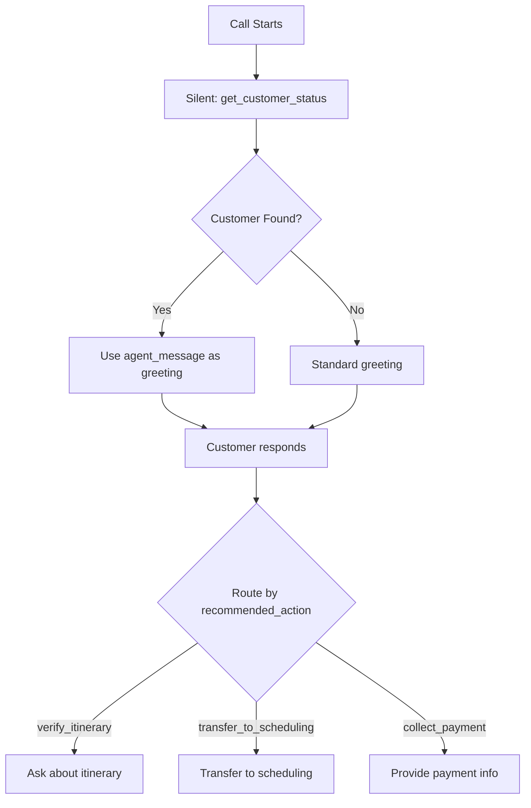

# Customer Status from Caller ID - Complete Summary

## ✅ What's Been Built

I've created a **comprehensive customer status endpoint** that returns EVERYTHING you need from just the caller ID in ONE API call.

---

## 🎯 The Solution

### Before (Multiple Calls):
```
1. /api/customer/lookup
2. /api/logic/deposits-check
3. /api/logic/travel-rep-check
4. /api/logic/booking-check
5. Agent interprets 4 responses
6. Agent writes greeting
```

### After (One Call):
```
1. /api/customer/status?phone={{call.from_number}}
2. Get pre-written {{agent_message}}
3. Done! ✅
```

---

## 📦 What You Get

**Single API Call Returns:**

```json
{
  "found": true,
  "status": {
    "overall": "ready_to_travel",
    "category": "active_customer",
    "recommended_action": "verify_itinerary",
    "agent_message": "Great news! Your deposits are complete and you're booked. Your travel rep is John Smith. Do you need your itinerary resent?"
  },
  "customer": {
    "customer_id": "123456",
    "full_name": "Sarah Johnson",
    "email": "sarah@email.com",
    "phone": "+18182121359"
  },
  "certificate": {
    "certificate_number": "BEACH123",
    "package_type": "BEACH",
    "confirmation_status": "confirm"
  },
  "deposits": {
    "status": "complete",
    "total_paid": 750,
    "expected_deposit": 750,
    "remaining": 0
  },
  "travel_rep": {
    "status": "complete",
    "name": "John Smith",
    "documents_sent": true
  },
  "travel_dates": {
    "scheduled": true,
    "start_date": "2025-06-15",
    "days_until_travel": 45
  },
  "booking": {
    "is_booked": true,
    "flight_booking": "FLIGHT123",
    "hotel_booking": "HOTEL456"
  }
}
```

---

## 🎤 Agent Message (Pre-Written!)

The API returns a **ready-to-use `agent_message`** based on the customer's exact situation:

| Customer Status | Agent Message |
|----------------|---------------|
| **Ready to Travel** | "Great news! Your deposits are complete and you're booked. Your travel rep is John Smith. Do you need your itinerary resent?" |
| **Deposits Complete** | "Your deposits are complete! You're all set to schedule your travel dates. Would you like me to transfer you to our scheduling team?" |
| **Partial Payment** | "I see you've paid $250 toward your $750 deposit. You have $500 remaining. Would you like to complete your payment today?" |
| **No Payment** | "Your deposits haven't been received yet. You can activate your certificate online at our website. Would you like me to send you the link?" |
| **Not Found** | Standard greeting: "Thank you for calling Casablanca Express. How may I help you today?" |

---

## 📋 Status Values

### Overall Status (`status.overall`)
- `ready_to_travel` - Deposits complete + Booked
- `ready_to_schedule` - Deposits complete + Travel date set
- `deposits_complete` - Deposits complete + No travel date
- `deposits_incomplete` - Partial payment
- `deposits_pending` - No payment
- `unknown` - Customer not found

### Recommended Action (`status.recommended_action`)
- `verify_itinerary` - Ask if they need itinerary
- `transfer_to_scheduling` - Transfer to schedule travel
- `offer_scheduling` - Ask when they want to travel
- `collect_payment` - Collect remaining balance
- `none` - Just answer their question

---

## 📁 Files Created

| File | Purpose |
|------|---------|
| **CUSTOMER-STATUS-API-GUIDE.md** | Complete API documentation with examples |
| **customer-status-tool-config.json** | Ready-to-paste Retell AI tool config |
| **DEPLOY-CUSTOMER-STATUS-ENDPOINT.md** | Deployment instructions |
| **CALLER-ID-LOOKUP-SETUP.md** | Step-by-step Retell AI setup guide |
| **rims-api-caspio.js** (updated) | API server with new endpoint (lines 1105-1304) |

---

## 🚀 Next Steps

### Step 1: Deploy to Railway ⏳

The code is ready but needs to be deployed to the correct Railway project.

**Follow**: [DEPLOY-CUSTOMER-STATUS-ENDPOINT.md](DEPLOY-CUSTOMER-STATUS-ENDPOINT.md)

**Options**:
1. Railway Dashboard → RIMS API Project → Deploy
2. Railway CLI: `railway link` → Select "RIMS API Project" → `railway up`
3. GitHub push (if connected)

**Test after deploying**:
```bash
curl "https://web-production-4080.up.railway.app/api/customer/status?phone=%2B18182121359"
```

### Step 2: Add Tool to Retell AI

1. Go to https://beta.retellai.com → **Tools** → **Create Custom Tool**
2. Use config from: [customer-status-tool-config.json](customer-status-tool-config.json)
3. Copy the tool ID

### Step 3: Add to Agent

1. Go to agent `***REMOVED***`
2. Add the `get_customer_status` tool
3. Update general prompt with lookup instructions (see [CALLER-ID-LOOKUP-SETUP.md](CALLER-ID-LOOKUP-SETUP.md))

### Step 4: Test

Call from: **+18182121359**

**Expected**:
- Agent silently looks up customer
- Agent says: "Great news! Your deposits are complete..." (or appropriate message)
- Agent knows certificate number, deposit status, travel rep, etc.

---

## 💡 How It Works in Agent Flow



---

## 🎯 Benefits

✅ **ONE API call** instead of 4-5 separate calls
✅ **Pre-written agent messages** - no need to construct greetings
✅ **Comprehensive status** - deposits, travel rep, booking, all in one
✅ **Recommended action** - agent knows exactly what to do next
✅ **Instant customer recognition** - knows who's calling immediately
✅ **Faster calls** - less latency, smoother conversation

---

## 📊 Example Scenarios

### Scenario 1: Active Customer, Ready to Travel
**Input**: `?phone=+18182121359`

**Output**:
```json
{
  "status": {
    "overall": "ready_to_travel",
    "agent_message": "Great news! Your deposits are complete and you're booked. Your travel rep is John Smith. Do you need your itinerary resent?"
  }
}
```

**Agent Says**: Exactly the agent_message above

---

### Scenario 2: Partial Deposits
**Input**: `?phone=+1310555XXXX`

**Output**:
```json
{
  "status": {
    "overall": "deposits_incomplete",
    "agent_message": "I see you've paid $250 toward your $750 deposit. You have $500 remaining. Would you like to complete your payment today?"
  },
  "deposits": {
    "remaining": 500
  }
}
```

**Agent Says**: The agent_message, then provides payment options

---

### Scenario 3: New Caller
**Input**: `?phone=+19999999999`

**Output**:
```json
{
  "found": false,
  "status": {
    "overall": "unknown",
    "category": "new_caller"
  }
}
```

**Agent Says**: "Thank you for calling Casablanca Express. How may I help you today?"

---

## ✅ Status

| Task | Status |
|------|--------|
| Code endpoint | ✅ Complete |
| Local testing | ✅ Complete |
| Create tool config | ✅ Complete |
| Write documentation | ✅ Complete |
| **Deploy to Railway** | ⏳ Needs deployment |
| Add to Retell AI | ⏳ After deployment |
| Test with calls | ⏳ After Retell setup |

---

## 📞 Ready to Use

Everything is coded, tested, and documented. Just need to:
1. Deploy to Railway (5 minutes)
2. Add tool to Retell AI (5 minutes)
3. Test!

**All documentation**: See files listed above in the `CBE-Discovery-Phase/` directory.

---

**Questions?** Everything is documented in the guide files. Start with [DEPLOY-CUSTOMER-STATUS-ENDPOINT.md](DEPLOY-CUSTOMER-STATUS-ENDPOINT.md) to get it live!
